# Travelling Llama 🦙

**Plan trips together. Decide as a herd.**

Travelling Llama is a trip planner for you and your travel buddies: destinations, a checklist, an
itinerary with real weather, **live flight lookups**, a shared budget, **expense settling**, and a
single shareable page that keeps itself up to date.

**Live app:** <https://travellingllama.fun>

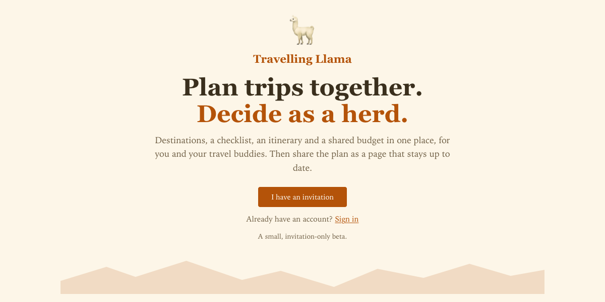

## The landing page

What a visitor sees before signing in. Every card and number on it is made-up example data.

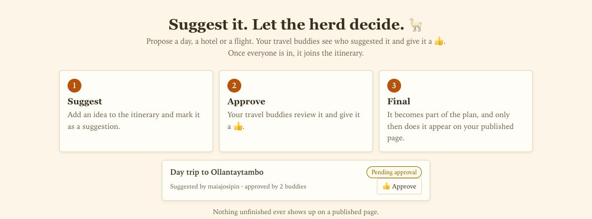

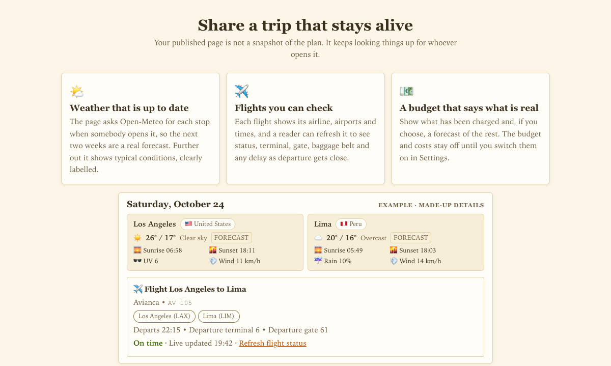

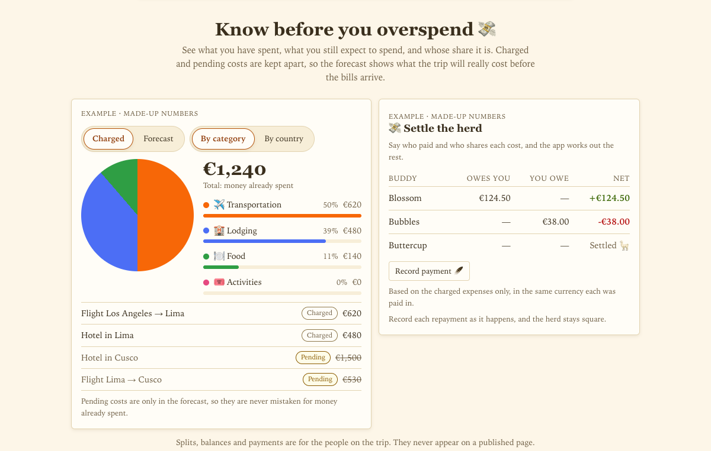

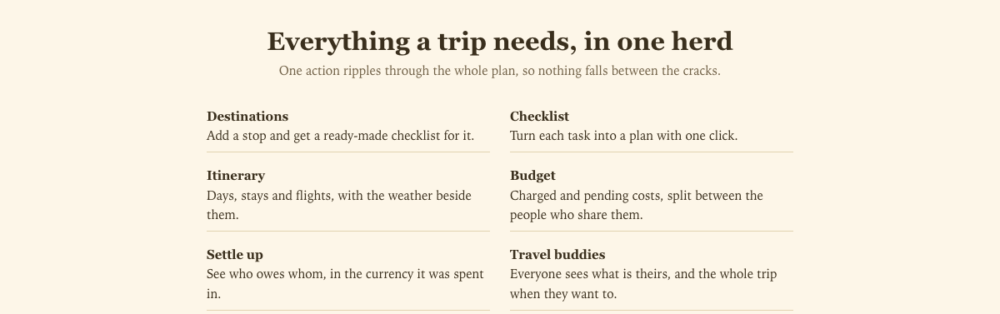

## Real-time flights ✈️

Type a flight number and a date and the app looks the flight up in live aviation data. It fills in
the airline, both airports (with time zones and coordinates), terminals and the times, and lets you
pick the right leg when a number flies more than one route in a day.

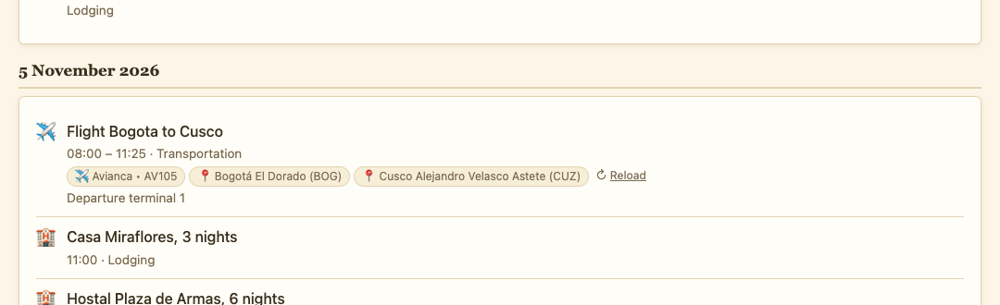

- **Looked up live.** The schedule comes from **AeroDataBox**. When a flight is within a couple of
  hours of departure, **AviationStack** adds the live extras: gate, baggage belt and delay.
- **Codeshares understood.** If you book on one airline's number but another operates the flight,
  the app finds the operating flight and remembers the mapping.
- **Readers can refresh it.** On the published page, anyone with the link can press *Reload* and see
  the current status, terminal, gate and delay as departure gets close, without signing in.
- **Built for free-tier APIs.** Results are cached with a lifetime that shrinks as departure nears
  (72 h, then 24 h, then 1 h), warmed once a night, capped per flight and per account, and guarded by
  a circuit breaker. If a provider is down, the page serves the last known record instead of failing.

## Weather you can plan around ☀️

Every itinerary day shows the weather for that stop, from **Open-Meteo**:

- **Within 14 days of the date**, a real forecast: temperature range, rain, wind, sunrise and sunset.
- **Further out**, typical climate for those dates, clearly labelled *Typical*, never passed off as a forecast.

A trip costs at most two weather calls however many stops it has, and the published page asks again
whenever someone opens it, so it never goes stale.

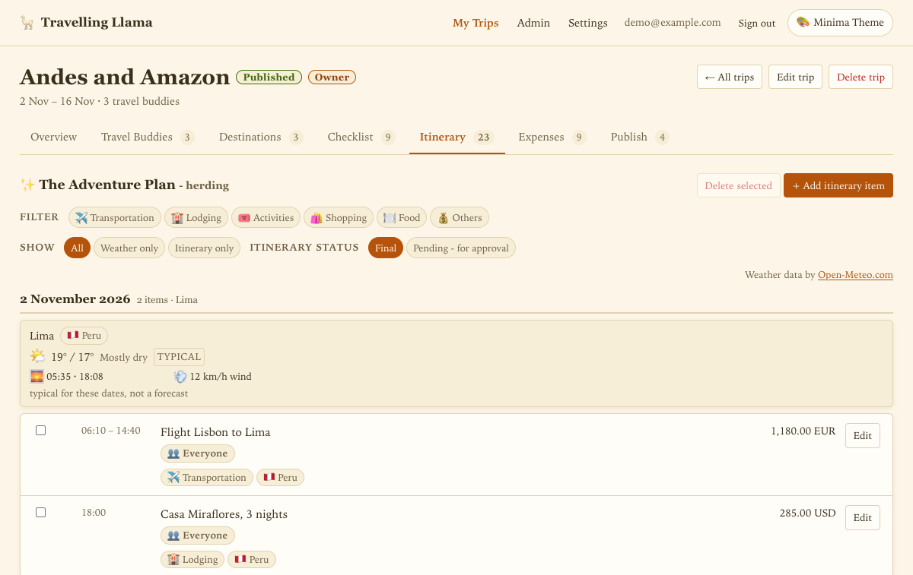

## Settling expenses 💸

Say who paid and who shares each cost, and the app works out the rest.

- **Any currency.** Each expense stays in the currency it was paid in, so a Lima dinner in soles and a
  hotel in dollars never get blurred together. The overview converts to your display currency using
  daily exchange rates.
- **Uneven splits.** Share a cost between everyone or only the people who were there.
- **Who owes whom, per currency**, with a line-by-line breakdown of exactly where each balance comes from.
- **Fewer transfers.** Optionally net the debts across the whole trip so fewer payments are needed.
- **Record payments as they happen.** A repayment settles the balance without counting as spending,
  so your totals stay true.
- **Charged vs pending.** Pending costs live only in the forecast, so a hotel you have not paid yet is
  never mistaken for money already spent.
- **Private to the group.** Balances and payments never appear on a published page.

| Settle the herd | Where every balance comes from |
| --- | --- |
| 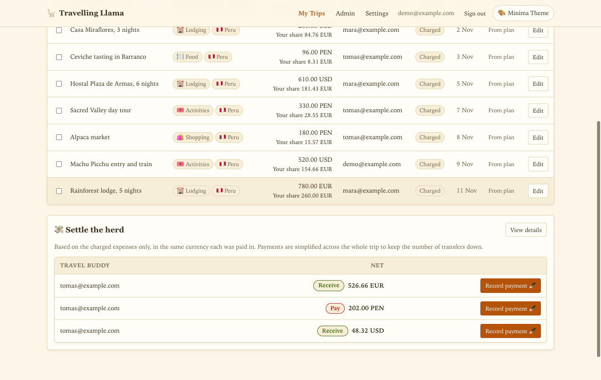 | 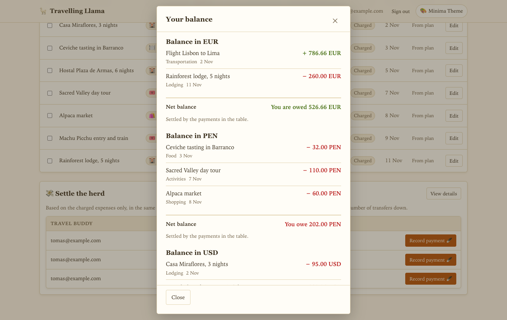 |

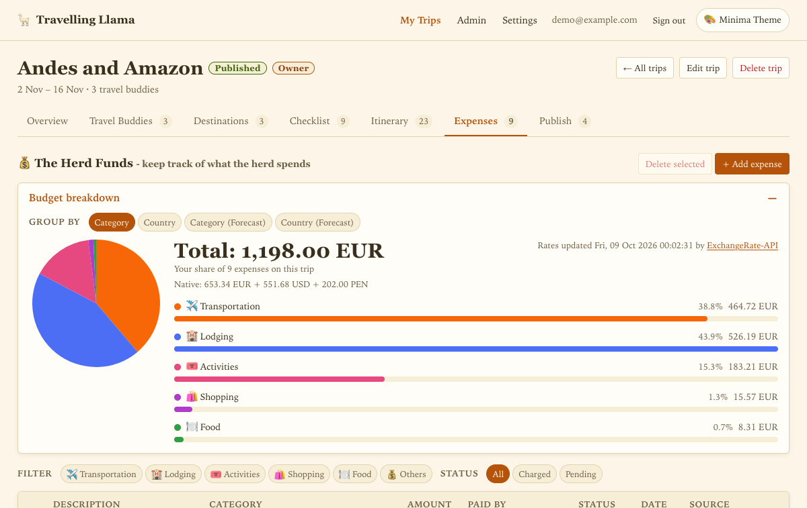

## How a trip comes together

The unit of work is the **checklist**. Adding a destination seeds checklist items for it, planning one
produces itinerary entries, and putting a cost on a plan produces a budget record.

1. **Create a trip** and invite travel buddies by email.
2. **Add destinations.** Type a place and it is looked up (country, coordinates, time zone). Each one seeds a checklist.
3. **Work the checklist.** Turn each item into a plan (a flight, a stay, an activity) from a pre-filled form.
4. **Suggest, then decide as a herd.** A suggestion is shown to everyone and only joins the plan once approved.
5. **Costs become budget**, split between the people who share them, and settle up at the end.
6. **Publish.** One self-contained HTML page per trip, plus a personal page for each traveller.

| Destinations | Checklist |
| --- | --- |
| 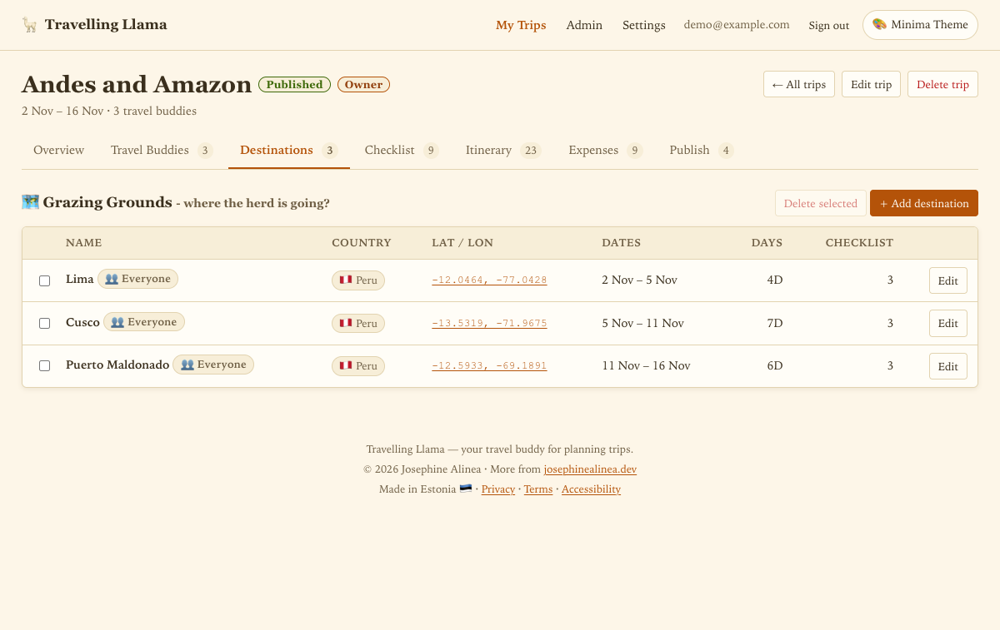 | 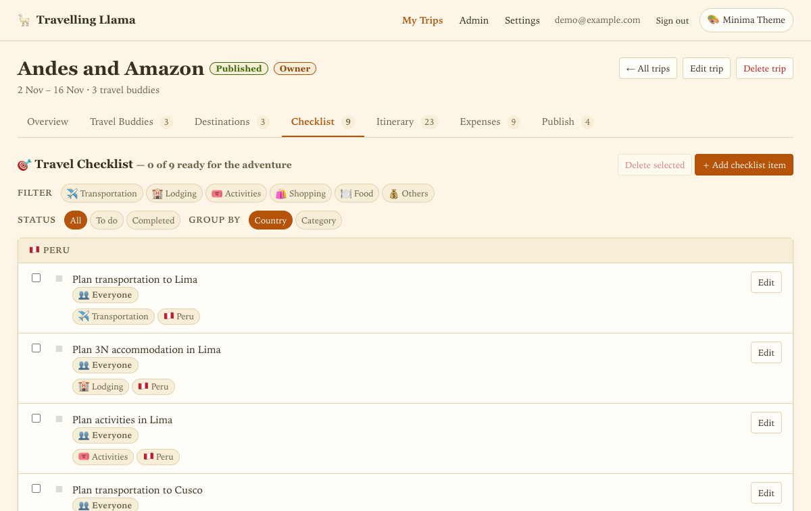 |

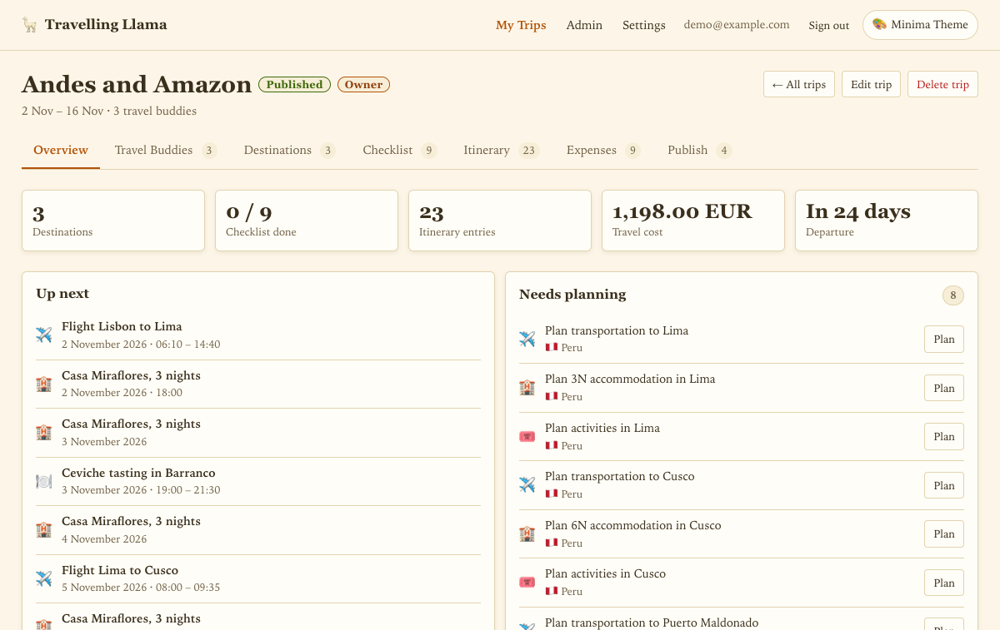

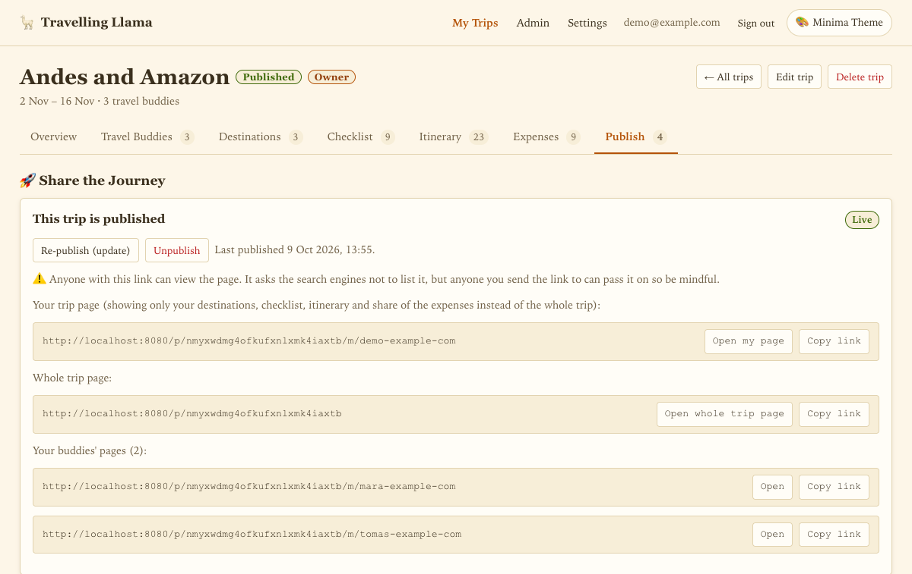

| The published page | On a phone | Dark theme |
| --- | --- | --- |
| 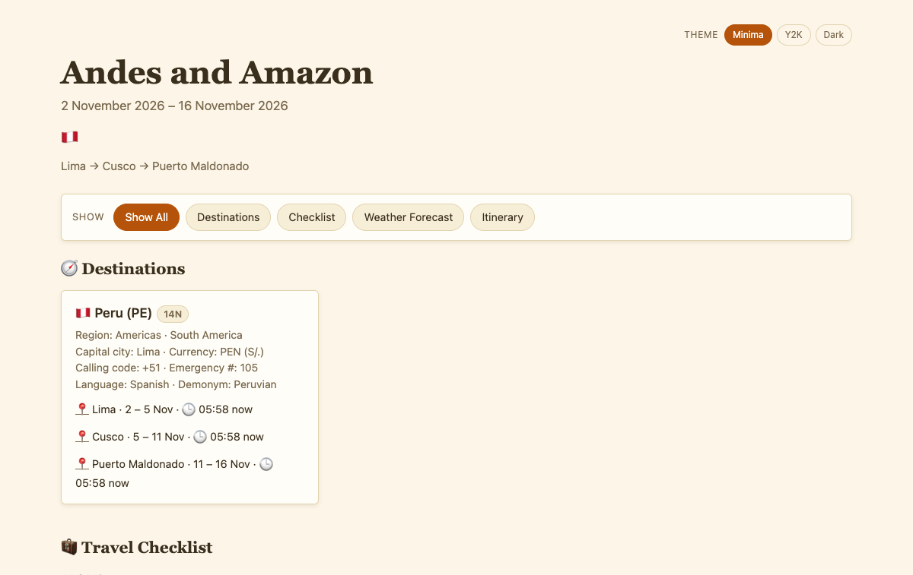 | 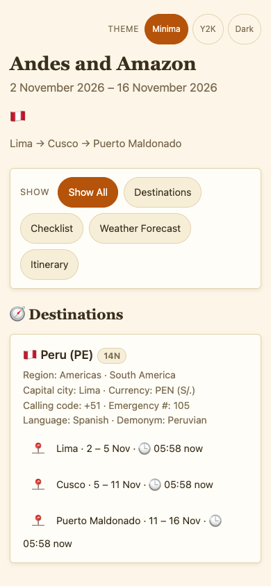 | 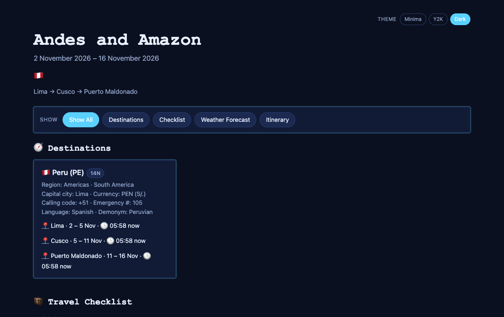 |

All app screenshots use made-up demo data.

## Third-party services and where each one is used

| Service | What it provides | Where you see it in the app | How it is used |
| --- | --- | --- | --- |
| **AeroDataBox** (via RapidAPI) | Flight schedule, airports, terminals, status, aircraft | The flight-number lookup when planning a flight; the flight card on published pages | On lookup, on a reader's refresh, and a nightly warm-up; cached and capped to stay within the free tier |
| **AviationStack** | Codeshare resolution; live gate, baggage belt and delay | The live status line on a flight card as departure nears | Only when the schedule data cannot answer, or within about 2 hours of departure |
| **Open-Meteo** (forecast and climate) | Daily weather: temperature, rain, wind, sunrise and sunset | Weather card on every itinerary day, in the app and on published pages | Real forecast within 14 days of the date, typical climate beyond; at most two calls per trip |
| **countries.dev** | Place search with country, coordinates, flags and currency | Destination autocomplete; flags and country cards; default currency for a plan | One lookup per pause in typing; the country list is fetched once and kept in memory |
| **open.er-api.com** (ExchangeRate-API) | Daily exchange rates | Budget totals in your display currency; the settle-up overview | About one call a day, refreshed on a schedule and when the table goes stale |
| **NewsData.io** and **Currents** | Destination news headlines (optional feature) | "Llama Lookout" news for a destination | Only when the feature is switched on |
| **Cloudflare R2** | Object storage for published pages | Public trip pages at `/p/<page key>` | Written on publish, read when someone opens the page |
| **Cloudflare Turnstile** | Bot check | The waitlist, sign-up and password-reset forms, and sign-in after repeated failures | One verification per submission |
| **Resend (SMTP)** | Email delivery | Invitations, temporary passwords, publish and payment notices, password reset | On the matching event |
| **Neon** (PostgreSQL) | The production database | Everything stored | Every request in database mode |

Every outbound call is wrapped so a failure never breaks the page that asked: it returns empty or
the last known value. Each integration is documented with what triggers it, how often it runs, what
is cached and how it fails.

## How the API is built

`planner-api` is a Spring Boot 3.5 / Java 21 service. Each feature is a module with the same four
layers: `domain` (stored records), `api` (services, where the rules live), `infra` (repository
interface plus its implementation) and `web` (controllers and request/response types).

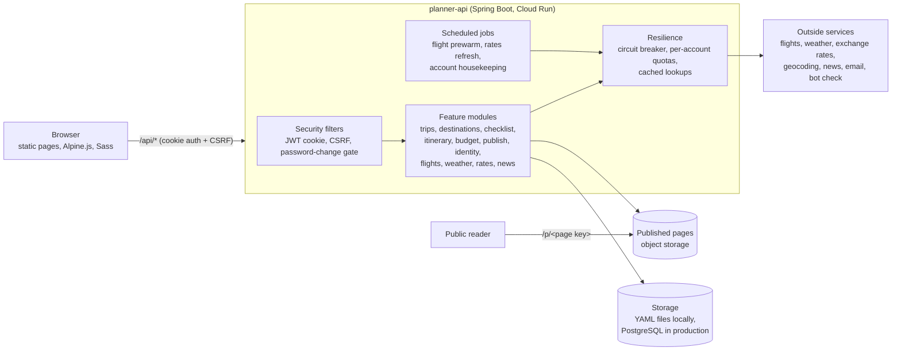

### Engineering highlights

- **Two storage back-ends behind one interface.** Local development runs on plain YAML files (no database to install); production runs on PostgreSQL with Flyway migrations. A flag switches between them, and the repositories are the only code that knows which.
- **Permissions in one place.** Trip roles (owner, member), per-destination traveller scoping, and the publish-approval flow are decided in the trips module rather than scattered across controllers.
- **Flaky third parties never break a page.** A shared **circuit breaker** pauses a failing service with an escalating back-off instead of retrying on every request.
- **Free-tier friendly by design.** Flight lookups are cached, pre-warmed nightly, and capped per flight and per account; every outside call is logged with its timing.
- **Secure by default.** Cookie-based JWT sessions, CSRF tokens on every state-changing request, forced password change on first sign-in, sign-in throttling and a bot check after repeated failures, and a waitlist-plus-invitation sign-up so strangers cannot self-register.
- **Documented API.** The OpenAPI document is generated from the code, committed, and a test fails when the committed copy is stale.
- **Every word is externalised.** All user-visible text lives in per-language message files and is read by key. Build checks fail on a key that is used but undefined, or defined but unused.
- **Accessibility scanned.** A scripted axe-core scan (WCAG 2.2 A and AA) covers every page and dialog in all three themes at desktop and phone width.
- **Tested.** About 270 production classes and 210 test classes (roughly 1,200 test cases), including database tests against a real PostgreSQL in a container.
- **Three themes**, each in its own stylesheet, plus a dark mode.

## Built with

Java 21 · Spring Boot 3.5 · PostgreSQL · Flyway · Testcontainers · springdoc-openapi ·
Alpine.js · Sass · Docker · Google Cloud Run · Neon · Cloudflare (Pages, R2)

## Credits

Weather data by [Open-Meteo.com](https://open-meteo.com/) (CC BY 4.0). Exchange rates by
[ExchangeRate-API](https://www.exchangerate-api.com). Flight data from AeroDataBox and AviationStack.

## Licence

Copyright (c) 2026 Josephine Alinea. All rights reserved. No licence is granted to use, copy or
modify anything shown here.
